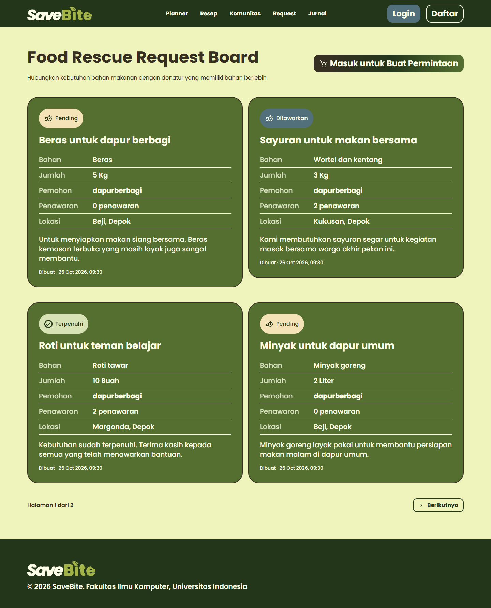
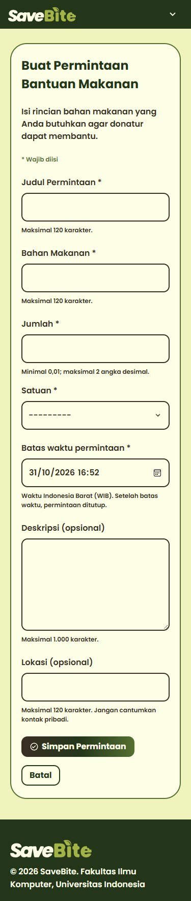
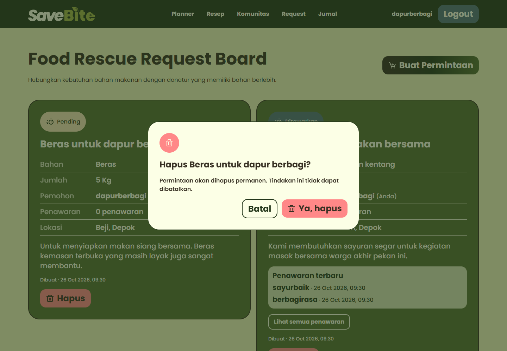

# Food Rescue Request Board

Modul SaveBite untuk mempertemukan pengguna yang membutuhkan bahan makanan dengan pengguna yang memiliki bahan berlebih. Pengguna membuat permintaan, menerima penawaran, memilih penawar, lalu menandai kebutuhan sebagai terpenuhi.

**Pengembang:** Reshandy Taftazani Aulya — 2506547651, PBP D / Kelompok 8.

[README utama](../Readme.md) · [AI Disclosure](ai_disclosure.md) · [Panduan pemeliharaan](OPERATIONS.md)

## Akses modul

- Aplikasi: [SaveBite](https://reshandy-taftazani-savebite.pws.cs.ui.ac.id).
- Modul: [Food Rescue Request Board](https://reshandy-taftazani-savebite.pws.cs.ui.ac.id/board/).
- Lokal: `http://127.0.0.1:8000/board/` setelah server dijalankan.

## Fitur dan hak akses

| Pengguna | Kemampuan |
| --- | --- |
| Pengunjung tanpa login | Membaca daftar permintaan, mencari dan memfilter data publik. |
| Pengguna login | Membuat permintaan dan menawarkan bahan melalui **Saya Punya!** pada permintaan pengguna lain. |
| Pemilik permintaan | Melihat penawar permintaannya, memilih penawar, menandai terpenuhi, dan menghapus permintaannya sendiri. |

Modul menyediakan pencarian judul, filter bahan/lokasi/status, filter permintaan sendiri untuk pengguna login, urutan terbaru/terlama, dan pagination maksimal 20 permintaan per halaman.

CRUD terdiri dari pembuatan permintaan (**Create**), pembacaan papan dan penawaran (**Read**), pembaruan status serta pemilihan penawar (**Update**), dan penghapusan permintaan sendiri (**Delete**). Update berfokus pada alur pemenuhan; modul tidak menyediakan halaman edit bebas untuk seluruh isi permintaan.

## Alur penggunaan

1. Buka `/board/` untuk membaca permintaan tanpa login.
2. Daftar melalui `/register/`, lalu masuk melalui `/login/` untuk berinteraksi.
3. Pilih **Buat Permintaan**. Isi judul, bahan, jumlah, satuan, dan batas waktu; deskripsi serta lokasi bersifat opsional. Simpan formulir.
4. Dari akun lain, buka permintaan dan pilih **Saya Punya!** untuk menawarkan bantuan.
5. Dari akun pemilik, buka **Lihat semua penawaran**, lalu pilih penawar yang akan membantu.
6. Pemilik dapat memilih **Tandai Terpenuhi** setelah penawar dipilih, atau **Hapus** untuk menghapus permintaan. Periksa dialog konfirmasi sebelum menyetujui penghapusan.

Jumlah minimal `0.01`, dengan maksimal dua angka desimal. Judul dan bahan maksimal 120 karakter; deskripsi maksimal 1.000 karakter. Batas waktu harus berada di masa mendatang. Zona waktu aplikasi adalah `Asia/Jakarta`.

### Status dan aturan interaksi

| Status | Makna |
| --- | --- |
| Pending (`pending`) | Belum menerima penawaran. |
| Ditawarkan (`offered`) | Sudah menerima penawaran. |
| Terpenuhi (`fulfilled`) | Pemilik menyelesaikan permintaan setelah memilih penawar. |
| Kedaluwarsa (`expired`) | Tenggat telah lewat dan permintaan belum terpenuhi; dihitung saat membaca data. |

Pengguna tidak dapat menawarkan bahan pada permintaannya sendiri atau membuat penawaran ganda untuk permintaan yang sama. Penawaran baru ditutup setelah penawar dipilih. Permintaan kedaluwarsa menolak penawaran, pemilihan penawar, dan pemenuhan. Identitas penawar dibatasi untuk pemilik permintaan. Izin aksi diperiksa di server, selain pembatasan tombol di UI.

## Tampilan modul

Screenshot berikut dirender dari template modul menggunakan **data sintetis**, bukan data pengguna produksi. Navbar dan footer mengikuti komponen bersama SaveBite. Gambar mengilustrasikan tampilan dan tidak menggantikan pengujian alur penggunaan.

### Papan permintaan di desktop



### Formulir di perangkat mobile



### Konfirmasi hapus



## Menjalankan secara lokal

Modul berjalan sebagai bagian dari proyek Django SaveBite. Jalankan perintah dari **root repositori**, tempat `manage.py` berada. Siapkan Python yang kompatibel dengan Django 5.2 (Python 3.10 atau lebih baru). Node.js/npm diperlukan hanya jika ingin membangun ulang CSS Tailwind.

Contoh PowerShell di Windows:

```powershell
python -m venv .venv
.\.venv\Scripts\Activate.ps1
python -m pip install -r requirements.txt
$env:PRODUCTION = 'False'
$env:DEBUG = 'True'
python manage.py migrate
python manage.py runserver
```

Jika aktivasi dibatasi PowerShell, gunakan `.\.venv\Scripts\python.exe` sebagai pengganti `python` setelah virtual environment dibuat. Pada Linux/macOS, gunakan `source .venv/bin/activate`, lalu `export PRODUCTION=False` dan `export DEBUG=True`.

Mode lokal memakai SQLite (`db.sqlite3`) tanpa kredensial PostgreSQL. Proyek memuat `.env`; pastikan mode lokal menggunakan `PRODUCTION=False`. Buat akun lewat halaman daftar. Instalasi baru tidak otomatis berisi contoh permintaan: gunakan dua akun untuk mencoba alur pemilik dan penawar.

Untuk perubahan sumber Tailwind:

```sh
npm ci
npm run css:build
```

Perintah ini membangun `assets/css/request-board-tailwind.css` menjadi `static/css/request-board-tailwind.css`. CSS hasil build sudah tersedia dalam repositori untuk menjalankan modul biasa. Sertakan perubahan sumber dan hasil build saat memperbarui utility Tailwind; jangan mengedit hasil build secara manual.

Ketiga halaman modul memuat `request-board-tailwind.css` untuk utility berprefiks `tw:` dan `request-board.css` untuk gaya komponen. Sumber Tailwind membatasi pemindaian pada template Request Board dan script terkait agar utility tidak tercampur dengan modul lain. Saat merilis perubahan CSS/JavaScript bersama, perbarui `ASSET_VERSION` sesuai [panduan pemeliharaan](OPERATIONS.md#shared-asset-releases).

## Struktur dan sumber data

| Lokasi | Tanggung jawab |
| --- | --- |
| `models.py` | Model `Request`, `RequestOffer`, dan `RequestCreationKey`. |
| `forms.py` | Validasi formulir permintaan dan filter. |
| `services.py` | Aturan bisnis dan perubahan data. |
| `views.py`, `urls.py` | Halaman HTML, aksi pengguna, dan adapter API. |
| `templates/request_board/` | Papan, formulir, daftar penawar, dan komponen tampilan. |
| `../static/css/request-board*.css` | Gaya antarmuka modul. |
| `../static/js/request-board*.js` | Interaksi browser, termasuk dialog dan pembaruan AJAX. |
| `migrations/` | Perubahan skema database. |
| `management/commands/cleanup_request_creation_keys.py` | Pembersihan kunci pembuatan lama. |
| `tests.py`, `test_*.py` | Pengujian aturan bisnis, akses, API, dan browser. |

Data permintaan dan penawaran berasal dari input pengguna di database SaveBite. Modul memakai autentikasi/session bersama proyek dan **tidak mengambil data dari TheMealDB**. `RequestCreationKey` menyimpan UUID per pemilik untuk mencegah permintaan ganda saat pengiriman diulang, termasuk ketika respons jaringan tidak diterima browser.

## Rute utama

| Metode | Rute | Fungsi |
| --- | --- | --- |
| GET | `/board/` | Daftar, pencarian, dan filter. |
| GET, POST | `/board/new/` | Formulir dan pembuatan permintaan. |
| GET | `/board/<id>/offers/` | Daftar penawar untuk pemilik. |
| POST | `/board/<id>/offer/` | Menawarkan bahan. |
| POST | `/board/<id>/offers/<offer_id>/select/` | Memilih penawar. |
| POST | `/board/<id>/fulfill/` | Menandai terpenuhi. |
| POST | `/board/<id>/delete/` | Menghapus permintaan sendiri. |
| GET | `/board/new/status/<uuid>/` | Memeriksa hasil pengiriman milik pengguna login. |
| GET, POST | `/requests` | Adapter API daftar/pembuatan. |
| POST | `/requests/<id>/offers` | Adapter API penawaran. |
| PATCH | `/requests/<id>/status` | Adapter API perubahan status. |
| DELETE | `/requests/<id>` | Adapter API penghapusan. |

Aksi perubahan data memerlukan login, izin yang sesuai, dan perlindungan CSRF. Adapter API memakai session Django, tanpa mekanisme token terpisah.

## Pengujian

```sh
python manage.py check
python manage.py test request_board --noinput
```

Suite mencakup validasi, akses, privasi penawar, pemilihan penawar, kedaluwarsa, filter, pengiriman ulang idempoten, dan interaksi browser. Hasil serta jumlah tes bergantung pada lingkungan dan versi kode; periksa keluaran runner, termasuk tes yang dilewati.

Untuk tes browser, pasang dependensi tambahan dan Chromium:

```sh
python -m pip install playwright
python -m playwright install chromium
python manage.py test request_board --noinput
```

Untuk Microsoft Edge yang sudah terpasang, set `$env:PLAYWRIGHT_CHROMIUM_CHANNEL = 'msedge'` pada PowerShell. Tes browser dapat dilewati jika dependensinya tidak tersedia. Tes konkurensi PostgreSQL dilewati pada SQLite; kelulusan di SQLite tidak membuktikan penguncian baris PostgreSQL. Lihat prasyarat database uji terisolasi dalam `test_concurrency.py` sebelum menjalankannya pada PostgreSQL.

## Pemeliharaan dan batasan

[OPERATIONS.md](OPERATIONS.md) menjelaskan migrasi, retensi kunci pembuatan selama 30 hari, penjadwalan cleanup harian di server, dan pembaruan versi aset. Cleanup menghapus catatan kunci lama, **bukan permintaan makanan**. Jadwal server tidak otomatis dibuat oleh repositori.

Modul mencatat kebutuhan serta penawaran; pemilihan penawar tidak membuktikan penyerahan fisik bahan telah berlangsung. Kelayakan makanan dan koordinasi penyerahan tetap diperiksa oleh pengguna.

## Penggunaan AI

Pengembangan menggunakan OpenAI Codex, Google Gemini, dan Antigravity dengan peran berbeda. Tujuan, strategi prompt, keterbatasan hasil AI, dan contoh koreksi dijelaskan dalam [AI Disclosure](ai_disclosure.md).
